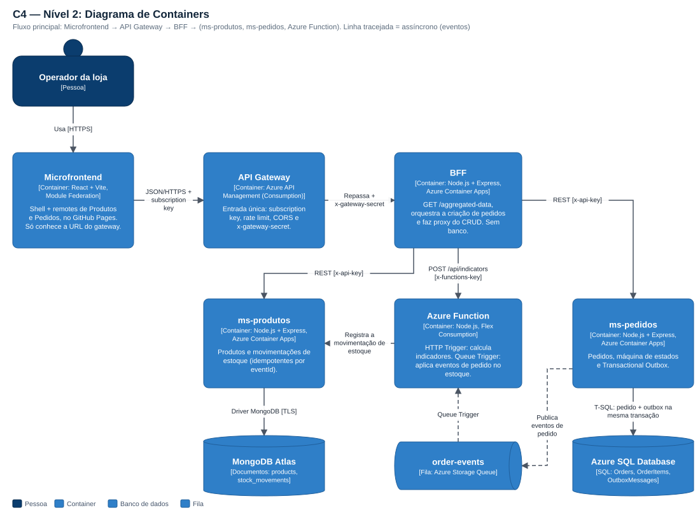

# pjbl-arquitetura — documentação, gateway e infraestrutura do Conecta Store

Este é o repositório "guarda-chuva" do nosso projeto PJBL de Arquitetura. Aqui não tem código de serviço: tem tudo o
que amarra os outros cinco repositórios — a documentação de arquitetura (ARC42, C4, Canvas), a definição do API Gateway,
o script que sobe a nuvem, o `docker-compose` para rodar tudo local e os scripts de apoio da demonstração.

## Os repositórios do projeto

| Repositório | O que é | Na nuvem |
|---|---|---|
| [pjbl-microfrontend](https://github.com/devinigarcia/pjbl-microfrontend) | Interface em React com Module Federation (shell + remotes de Produtos e Pedidos) | https://devinigarcia.github.io/pjbl-microfrontend |
| [pjbl-bff](https://github.com/devinigarcia/pjbl-bff) | Backend for Frontend (Node + Express): agregação, orquestração e proxy | https://bff.agreeablesand-8dc3837e.brazilsouth.azurecontainerapps.io/docs |
| [pjbl-ms-produtos](https://github.com/devinigarcia/pjbl-ms-produtos) | Microserviço de produtos e estoque — MongoDB Atlas | https://ms-produtos.agreeablesand-8dc3837e.brazilsouth.azurecontainerapps.io/docs |
| [pjbl-ms-pedidos](https://github.com/devinigarcia/pjbl-ms-pedidos) | Microserviço de pedidos — Azure SQL, outbox e eventos | https://ms-pedidos.agreeablesand-8dc3837e.brazilsouth.azurecontainerapps.io/docs · [eventos](https://ms-pedidos.agreeablesand-8dc3837e.brazilsouth.azurecontainerapps.io/events/docs) |
| [pjbl-function](https://github.com/devinigarcia/pjbl-function) | Azure Function: HTTP Trigger (indicadores) e Queue Trigger (estoque) | https://func-pjbl-0a42b2.azurewebsites.net/api/docs |
| **pjbl-arquitetura** (este) | Documentação, gateway, infraestrutura e scripts | — |

Entrada oficial da aplicação (API Gateway): https://apim-pjbl-0a42b2.azure-api.net/conecta
Vídeo da apresentação: {{URL_VIDEO}}
Imagens no Docker Hub: [pjbl-bff](https://hub.docker.com/r/vinigarciaa/pjbl-bff) ·
[pjbl-ms-produtos](https://hub.docker.com/r/vinigarciaa/pjbl-ms-produtos) ·
[pjbl-ms-pedidos](https://hub.docker.com/r/vinigarciaa/pjbl-ms-pedidos)

## Arquitetura em uma imagem



O caminho de uma requisição é sempre **Microfrontend → API Gateway → BFF → (ms-produtos, ms-pedidos, Azure Function)**.
O front não conhece os microserviços, e os microserviços não se conhecem.

A parte assíncrona (linhas tracejadas) é a baixa de estoque: quando um pedido é criado, o ms-pedidos grava o pedido e o
evento `order.created` **na mesma transação** (Transactional Outbox), publica o evento na fila `order-events`, e a
Azure Function consome a fila e registra a saída no ms-produtos. Cancelou o pedido? Sai um `order.cancelled` e o estoque
volta. Cada movimentação leva um `eventId`, então mensagem repetida não baixa o estoque duas vezes.

Padrões aplicados: Clean Architecture, Vertical Slice, Event-Driven (outbox + fila + consumidor idempotente),
API Gateway + BFF + microserviços + serverless, um banco por serviço (MongoDB e Azure SQL).

## O que tem aqui

```
pjbl-arquitetura/
├── docs/
│   ├── entrega/Entrega3-ConectaStore.pdf   documento final (ARC42 + C4 + Canvas + prints)
│   ├── entrega/arc42.template.html         texto do documento
│   ├── c4/                                 diagramas em SVG + workspace.dsl (Structurizr)
│   ├── diagramas/                          código que gera os SVGs
│   ├── prints/                             capturas de tela usadas no PDF
│   ├── contratos.md                        contrato HTTP e de eventos entre os serviços
│   └── roteiro-video.md                    roteiro da apresentação, dividido por aluno
├── gateway/
│   ├── azure-apim/                         policy e script do Azure API Management (o que está publicado)
│   └── aws/                                definição equivalente para AWS API Gateway (alternativa)
├── infra/
│   ├── deploy-azure.ps1                    cria/atualiza toda a parte Azure
│   └── remover-azure.ps1                   apaga tudo depois da apresentação
├── scripts/
│   ├── seed.mjs                            dados de demonstração (produtos e pedidos)
│   ├── preencher-links.mjs                 troca os {{placeholders}} dos READMEs pelos links reais
│   ├── gerar-diagramas.mjs                 gera os SVGs do C4
│   ├── tirar-prints.mjs                    tira os prints (Edge headless)
│   └── gerar-pdf.mjs                       monta e imprime o PDF da entrega
├── docker-compose.yml                      sobe o sistema inteiro local (para quem tem Docker)
├── links.json                              URLs publicadas (sem segredo nenhum)
└── alunos.json                             integrantes do grupo
```

## Documentação

| Documento | Onde |
|---|---|
| **PDF da Entrega 3** (ARC42, C4, Canvas, prints, links) | [docs/entrega/Entrega3-ConectaStore.pdf](docs/entrega/Entrega3-ConectaStore.pdf) |
| C4 nível 1 — Contexto | [docs/c4/c4-1-contexto.svg](docs/c4/c4-1-contexto.svg) |
| C4 nível 2 — Containers | [docs/c4/c4-2-containers.svg](docs/c4/c4-2-containers.svg) |
| C4 nível 3 — Componentes | [BFF](docs/c4/c4-3-componentes-bff.svg) · [ms-pedidos](docs/c4/c4-3-componentes-ms-pedidos.svg) · [ms-produtos](docs/c4/c4-3-componentes-ms-produtos.svg) · [Function](docs/c4/c4-3-componentes-function.svg) |
| Visão de implantação | [docs/c4/implantacao.svg](docs/c4/implantacao.svg) |
| Fluxos (sequência) | [/aggregated-data](docs/c4/runtime-1-aggregated-data.svg) · [pedido + evento](docs/c4/runtime-2-pedido-evento.svg) |
| Modelo em Structurizr DSL | [docs/c4/workspace.dsl](docs/c4/workspace.dsl) |
| Contratos entre os serviços | [docs/contratos.md](docs/contratos.md) |
| API Gateway (Azure e alternativa AWS) | [gateway/README.md](gateway/README.md) |
| Roteiro do vídeo | [docs/roteiro-video.md](docs/roteiro-video.md) |

## Tecnologias

- **Linguagem:** TypeScript (Node.js 22) em todos os projetos
- **Front:** React, Vite, Module Federation
- **Back:** Express 5, zod, pino
- **Bancos:** MongoDB Atlas (M0) e Azure SQL Database (oferta gratuita serverless)
- **Mensageria:** Azure Storage Queue
- **Serverless:** Azure Functions (Flex Consumption)
- **Gateway:** Azure API Management (Consumption)
- **Hospedagem:** Azure Container Apps, GitHub Pages
- **Entrega:** Docker, Docker Hub, GitHub Actions
- **Testes:** Vitest, Supertest, Testing Library e testes de arquitetura próprios

## Como rodar tudo localmente

Clone os seis repositórios lado a lado, na mesma pasta:

```
pjbl/
├── pjbl-arquitetura/
├── pjbl-bff/
├── pjbl-ms-produtos/
├── pjbl-ms-pedidos/
├── pjbl-function/
└── pjbl-microfrontend/
```

### Com Docker (mais simples)

```bash
cd pjbl-arquitetura
cp .env.example .env          # no Windows: copy .env.example .env
docker compose up --build
```

Sobe MongoDB, SQL Server, Azurite (emulador da fila), os dois microserviços, a Function, o BFF e o front.
Front em http://localhost:8080 e BFF em http://localhost:3000/docs. Depois, para ter dados:

```bash
node scripts/seed.mjs
```

### Sem Docker

Dá para rodar só com Node. Cada serviço tem um modo "memória" que dispensa banco. Um terminal para cada:

```bash
cd pjbl-ms-produtos && npm install && npm run dev      # porta 3001
cd pjbl-ms-pedidos  && npm install && npm run dev      # porta 3002
cd pjbl-bff         && npm install && npm run dev      # porta 3000
cd pjbl-microfrontend && npm install && npm run build && npm run preview
```

Para o fluxo de eventos completo (fila + Function) é preciso também o Azurite e o Azure Functions Core Tools; o passo a
passo está no README do `pjbl-function`.

## Como publicar na nuvem

Pré-requisitos: conta Azure (usamos Azure for Students), cluster gratuito no MongoDB Atlas com acesso de rede liberado
(`0.0.0.0/0`), Azure CLI logado (`az login`) e as três imagens já no Docker Hub (o GitHub Actions de cada repositório publica).

```powershell
cd pjbl-arquitetura
./infra/deploy-azure.ps1 -DockerHubUser vinigarciaa -PublisherEmail seu-email@exemplo.com
```

O script pede a connection string do Atlas de forma oculta, cria os recursos (resource group, fila, Azure SQL gratuito,
Container Apps, Function App, API Management), gera os segredos direto nos serviços e grava as URLs em `links.json`.
Pode ser executado de novo sem duplicar nada. Parâmetros úteis:

| Parâmetro | Para que serve |
|---|---|
| `-Location` | Região (padrão `brazilsouth`). Assinaturas de estudante às vezes só liberam algumas regiões. |
| `-MinReplicas 1` | Mantém os containers ligados (sem espera na primeira chamada). Bom para o dia da apresentação. |
| `-SkipGateway` / `-SkipFunctionCode` | Pula uma etapa. |
| `-OnlyBase` | Cria só a base (resource group, fila, Azure SQL e ambiente de containers), sem depender das imagens nem do Atlas. |
| `-MongoHost` e `-MongoUser` | Informa o endereço do cluster e o usuário do banco; o script pede só a senha. Com `-MongoPasswordFromClipboard`, ele lê a senha copiada no site do Atlas. |

Depois do deploy:

```powershell
# dados de demonstração, passando pelo gateway
$env:API_URL = "https://apim-pjbl-0a42b2.azure-api.net/conecta"
$env:API_KEY = "<subscription key do gateway>"
node scripts/seed.mjs

# preenche os links nos READMEs de todos os repositórios
node scripts/preencher-links.mjs

# tira os prints e gera o PDF
node scripts/tirar-prints.mjs paginas
node scripts/tirar-prints.mjs gateway
node scripts/gerar-pdf.mjs
```

Quando a disciplina terminar, `./infra/remover-azure.ps1` apaga o resource group inteiro (pede confirmação).

### Segredos

Nenhum segredo fica neste nem nos outros repositórios. A senha do SQL, as chaves internas dos microserviços e o segredo
do gateway são gerados pelo script de deploy e gravados direto nos *secrets* do Container Apps e no API Management.
Os arquivos `links.json` e `alunos.json` só têm URLs públicas e nomes.

## Custos

Tudo em camada gratuita ou de consumo: GitHub, Docker Hub e Atlas M0 são gratuitos; o Azure SQL usa a oferta gratuita
com pausa automática (não gera cobrança); API Management Consumption, Functions Flex Consumption e Container Apps ficam
dentro da franquia mensal com o uso de um projeto de disciplina.

## Alunos

- Arthur Ambrozewicz Cidral
- Erick Marlon Barbieri da Silva
- Luan Alberti Estevinho
- Vinícius de Oliveira Garcia
